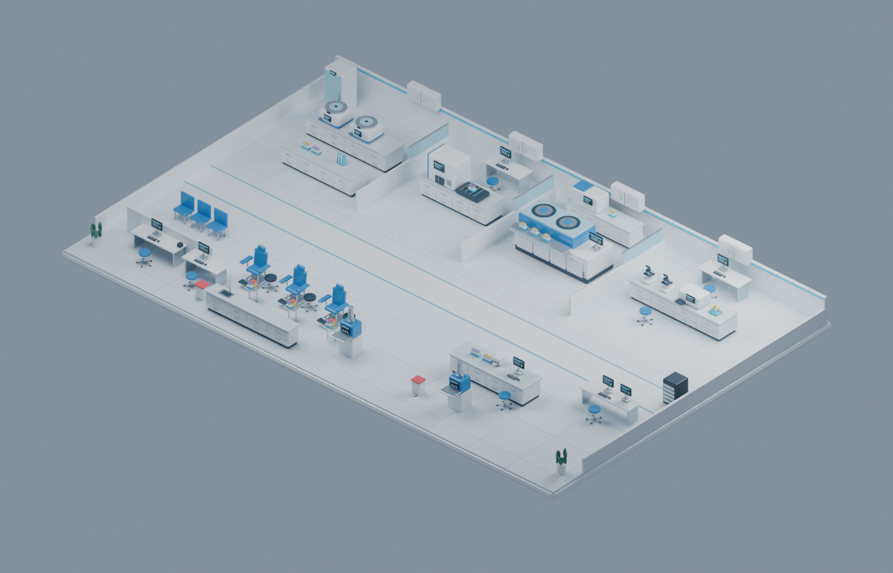

# LabFlow — ห้องปฏิบัติการจำลอง

Simulator ภาษาไทย สำหรับติดตาม **ผู้รับบริการ → สิ่งส่งตรวจ → ข้อมูลผลตรวจ** ผ่านรหัสผู้ป่วย (P), ครั้งรับบริการ (V), คำสั่งตรวจ (O), สิ่งส่งตรวจ (S) และผลตรวจ (R)

## เปิดใช้งาน

**เปิด Simulator:** https://peerapat-mt.github.io/labflow-simulator/

เว็บสำรอง: https://amnat-labflow-simulator.phaktaphap.chatgpt.site

**ดาวน์โหลดวิดีโอสำหรับ Facebook / IG:** [GitHub Releases](https://github.com/peerapat-MT/labflow-simulator/releases)



บนเครื่องนี้: ดับเบิลคลิก `start-simulator.cmd` แล้วเปิด http://127.0.0.1:4173 ต้องมี Node.js 22 ขึ้นไป ปิดหน้าต่าง server เพื่อหยุดบริการ

จาก terminal ในโฟลเดอร์นี้:

```powershell
npm run dev
```

ไฟล์ `dist/` มี Three.js และฟอนต์อยู่ในตัว ไม่ต้องติดตั้ง dependencies หรือเชื่อมอินเทอร์เน็ตเพื่อใช้งาน local ไม่มี backend ไม่มี API key และไม่มีการเชื่อมระบบ HIS จริง เปิด `index.html` ผ่าน file:// โดยตรงไม่ได้เพราะใช้ JavaScript modules

## ภาพและการควบคุมรุ่น 2.0

ธีมฟ้าน้ำเงินใหม่ พร้อมห้องแล็บและคนที่สร้างใน **Blender 4.5.4 LTS** โมเดล GLB ใช้วัสดุ PBR ขอบโค้ง แสงสะท้อนจาก environment และเงานุ่ม มีไฟล์ต้นฉบับแก้ไขต่อได้ที่ [assets-source](assets-source/README.md)

- เลือกคุณภาพ **อัตโนมัติ / รายละเอียดสูง / ประหยัดทรัพยากร** โหมดอัตโนมัติลดความละเอียดเมื่อใช้เวลาวาดภาพสูง โหมดประหยัดปิดเงาเพื่อช่วยเครื่องที่ช้า
- ปุ่มบนฉากใช้เปิด/ปิดป้ายห้อง ซูมเข้ารายการที่เลือก สลับมุมมองบน/สามมิติ และเปิดเต็มจอ
- คนมีข้อต่อแขน ขา และเข่า เดินตามทางเชื่อมและนั่งเก้าอี้เก็บตัวอย่าง กล้องและหลอดเคลื่อนต่อเนื่องตามเวลาวาดภาพของเบราว์เซอร์
- เมื่อหยุดจำลอง การเคลื่อนไหวหยุดด้วย แต่ยังหมุน/ซูมกล้องได้ เคารพการตั้งค่าลดการเคลื่อนไหวของระบบ
- ภาพเป็นการนำเสนอสถานะด้วย interpolation ไม่ใช่การคำนวณเวลาขนส่งทางกายภาพ ตัวเลขเวลา คิว และ audit มาจาก engine เดิม โดยการวาดภาพไม่แก้ไขข้อมูลเหล่านั้น

รูปทรงและตำแหน่งอุปกรณ์เป็นห้องแล็บตัวอย่าง ยังไม่ใช่แบบสำรวจพื้นที่จริง รายละเอียดภาพเพิ่มขึ้น แต่ความเร็วที่ได้ขึ้นกับ GPU ขนาดหน้าจอ และคุณภาพที่เลือก ไม่รับประกันอัตราเฟรมตายตัวทุกเครื่อง

## ใช้งาน

1. หน้า **ห้องแล็บ** เริ่มแสดงงานหลัง 15 นาทีจาก 08:00 น. ความเร็วตั้งต้น 30× เลือกคน หลอด ห้อง หรือเลือกจากรายการผู้รับบริการเพื่อดูทั้งสามเส้นทาง กดหยุด/เดินทีละนาทีเมื่อฝึกขั้นตอน
2. **LIS / HIS** แสดงผลภายใน LIS แยกจากเวอร์ชันที่ HIS ได้รับ ปิดอนุมัติอัตโนมัติสำหรับการฝึกด้วยมือ ผลต้องผ่านการตรวจสอบและอนุมัติจึงเข้าคิวส่ง HIS
3. **ทดลองสถานการณ์** เพิ่มผู้รับบริการ หยุดกระสวย หยุดเครื่องตรวจ QC ไม่ผ่าน HIS ไม่ตอบรับ หรือรหัสบนหลอดไม่ตรง “คืนระบบปกติ” ดำเนินงานค้างต่อ
4. ตัวอย่างที่พักรับสามารถ **ขอเก็บใหม่** ได้ ต้องเข้าคิวใช้ทรัพยากรเก็บตัวอย่างอีกครั้ง มี barcode ใหม่และรหัสอ้างถึงตัวอย่างเดิม
5. **ประสิทธิภาพ** ดู P50/P95, SLA, คิวและการใช้ทรัพยากร ส่งออกข้อมูลรอบ JSON หรือผล CSV ได้
6. **ตั้งค่าระบบ** ปรับค่าตามข้อมูลจริง นำเข้า/ส่งออก JSON ค่าจะบันทึกใน localStorage ของเบราว์เซอร์นั้น รอบจำลองไม่ถูกเก็บอัตโนมัติเมื่อปิดหน้า

## สิ่งที่จำลอง

- ขึ้นบัตร/ยื่นบัตร → คิวเก็บเลือดและปัสสาวะ → รอเที่ยวขนส่ง → ถึงจุดรับ → ตรวจรับ → เตรียม/ปั่นแยก batch → คิววิเคราะห์ → **รายงานผล = บันทึกใน LIS** → ตรวจสอบ → อนุมัติ → ส่ง → ACK → แสดงใน HIS
- CBC, เคมีคลินิก, UA และภูมิคุ้มกัน ร่วมกับหลอด EDTA, serum, urine; serum ที่ใช้หลายห้องแบ่งเป็น aliquot พร้อมรหัสเชื่อม
- กระสวย: ช่วงเที่ยว ความจุเป็นจำนวนภาชนะ จำนวน carrier เวลาไป/กลับ เส้นทางเก็บตัวอย่าง→จุดรับ ชนิดตัวอย่างที่อนุญาต และนโยบายส่งสำรอง/รอเกินเกณฑ์
- ส่งสำรอง: คิว ช่วงเที่ยว ความจุ เวลาไป/กลับ จำนวนทีม
- QC เป็นสถานะจำลอง pass/fail: งานที่ยังไม่ปล่อยผลถูกกักและวิเคราะห์ใหม่หลังแก้ QC งานที่อนุมัติและส่งออกไปแล้วไม่ถูกถอนย้อนหลังโดยอัตโนมัติ
- HIS ขัดข้องเก็บงานใน outbox, retry แบบ backoff สูงสุด 120 วินาที, message ID เดิมตามผล/เวอร์ชัน, การส่งที่สำเร็จไม่ปล่อยผลซ้ำ
- การแก้ไขผลเก็บฉบับเดิมและเหตุผล สร้างเวอร์ชันใหม่เพื่ออนุมัติอีกครั้ง HIS คงผลเดิมจนได้รับฉบับใหม่
- ค่าวิกฤตจำลองมีงานบันทึกผู้รับแจ้งและการอ่านทวนแยกจากการปล่อยผล ไม่มีการโทร/ส่งข้อความจริง

## ความหมายของตัวเลข

| ตัวชี้วัด | เหตุการณ์เริ่ม → จบ |
|---|---|
| รอก่อนเจาะเลือด | ขึ้นบัตร → เริ่มเก็บเลือด |
| รอเที่ยว | เก็บตัวอย่าง → ออกเดินทาง |
| รอตรวจรับ | ถึงจุดรับ → รับเข้าระบบสำเร็จ |
| Lab TAT | รับเข้าระบบ → อนุมัติผล |
| Interface TAT | อนุมัติ → แสดงใน HIS |
| End-to-end | ขึ้นบัตร → ผลครบทุกห้องใน HIS |

P50/P95 และ SLA นับเฉพาะงานที่เสร็จในชุดตัวชี้วัดนั้น งานค้างแสดงแยกไว้เพื่อให้เห็นการ censored ของข้อมูล SLA เป็นเป้าตั้งต้นจำลอง ผลแก้ไขใช้เวลาจากตัวอย่างเดิมจนอนุมัติฉบับปัจจุบัน จึงควรแยกจากรอบปกติเมื่อวิเคราะห์ข้อมูลส่งออก

## ขอบเขตและการปรับเทียบ

**ทุกค่าเริ่มต้นเป็นสมมติฐาน ยังไม่ได้ใช้ข้อมูลระบบจริงของโรงพยาบาล** ป้าย “ข้อมูลจริงที่ผู้ใช้ระบุ” หมายถึงผู้ใช้เลือกฐานข้อมูลนั้นเอง ไม่ใช่การตรวจสอบข้อมูลอัตโนมัติ อ่าน [แนวทางเก็บข้อมูลจริง](docs/calibration-guide.md) ก่อนนำค่ามาใช้

รุ่นนี้จำลอง OPD, workflow และความจุของทรัพยากร ไม่มีผลทางคลินิกจริง ไม่จำลองความแม่นยำวิธีตรวจ เกณฑ์ QC เชิงสถิติ reference interval การเพาะเชื้อ ธนาคารเลือด หรือพยาธิวิทยา ไม่ใช่ระบบอนุมัติผลสำหรับผู้ป่วยจริง

เครื่องตรวจใช้จำนวนช่องงานขนานและเวลาต่อ panel แทนสเปกเครื่องจริง การเก็บปัสสาวะปกติเป็น delay หลังเจาะเลือด ระบบขนส่งมีหนึ่งเส้นทางต้นทาง→ปลายทาง ไม่จำลองการสับรางเครือข่ายหลายสถานีหรือมวล/ขนาด carrier ตัวอย่างที่เก็บใหม่มีคิวและเวลาเก็บ แต่ยังไม่คิดเวลาที่ใช้ตามผู้ป่วยกลับมา

การปั่นเป็น batch ของ serum, ทำได้พร้อมกันหนึ่ง batch โดยเริ่มเมื่อเต็มหรือครบเวลารวม batch การกระจายไปเครื่องอื่นใช้เวลาคงที่ ไม่มีอัตราความเสียหายจากการขนส่งเชิงกายภาพ

การเปรียบเทียบทรัพยากรควรใช้ seed เดิม ช่วงเวลาจำลองเท่ากัน และเริ่มรอบใหม่ การตั้งค่ากลางรอบใช้กับงานใหม่ งานที่จองเวลาหรือเที่ยวไว้แล้วไม่ถูกเลื่อนย้อนหลัง utilization กลางรอบจึงเป็นค่าประมาณ

จำกัด 2,000 ผู้รับบริการต่อรอบ ภาพแสดงคนสูงสุด 88 คนรวมเจ้าหน้าที่ และหลอดที่ยังมีงานสูงสุด 180 หลอดเพื่อรักษาความลื่น จำนวนคิวและข้อมูลใช้รายการทั้งหมด Audit ส่วนกลางเก็บ 10,000 เหตุการณ์ล่าสุด ประวัติรายผู้ป่วย/ตัวอย่าง/ผลยังอยู่ในข้อมูลรอบ

## ตรวจสอบ / พัฒนา

```powershell
npm test
python tests/browser_test.py
python tests/render_test.py
python tests/scene_controls_test.py
```

Browser tests ต้องเปิด local server และมี Python Playwright/Chromium ทดสอบ headless เท่านั้น ผลภาพและรายงานอยู่ใน `.qa/` (ไม่เผยแพร่)

เมื่อเปลี่ยน Three.js: `npm install` และ `npm run vendor` เวอร์ชันปัจจุบันล็อกใน package-lock.json

แยก engine (`dist/js/engine.js`) จากภาพ (`world.js`, `motion.js`) และ UI (`app.js`) ใช้ discrete events ตามเวลา/ลำดับเหตุการณ์และ seeded RNG เดินเวลาเร็ว/ช้าไม่เปลี่ยนผลลัพธ์ของ seed และค่าเดียวกัน ภาพคนและหลอดใช้ GPU instancing และทรัพยากรร่วมกัน มีการทดสอบการหยุด การเปลี่ยนเส้นทาง กล้อง โมเดล และการรีเซ็ตโดยไม่สะสม geometry

หลักฐาน: [บันทึกงานวิจัย](docs/lab-workflow-research.md) และปุ่มคู่มือในแอป ฟอนต์ Noto Sans Thai ใช้ OFL, Three.js ใช้ MIT ดู license ที่ `dist/vendor/` และ `dist/assets/`

## การเผยแพร่บน GitHub Pages

Repository นี้เป็น snapshot สาธารณะที่ไม่รวมการตั้งค่า Sites ส่วนตัวหรือประวัติ Git ของระบบเดิม ผู้เข้าชมอ่านและดาวน์โหลดซอร์สได้ แต่ไม่ได้รับสิทธิ์ push แก้ไข repository นี้

Branch `main` เก็บซอร์สและไฟล์ Blender ส่วน `gh-pages` เผยแพร่เนื้อหาจาก `dist/` การอัปเดตหลังแก้ไขและทดสอบ:

```powershell
git add .
git commit -m "Update LabFlow"
git push origin main
git subtree push --prefix dist origin gh-pages
```

วิดีโอเป็นข้อมูลสังเคราะห์และภาพจากแบบจำลอง ไม่ใช่ภาพผู้ป่วยหรือข้อมูลผลตรวจจริง วิดีโอแยกอยู่ใน Releases เพื่อไม่เพิ่มขนาดประวัติ Git โดยไม่จำเป็น
